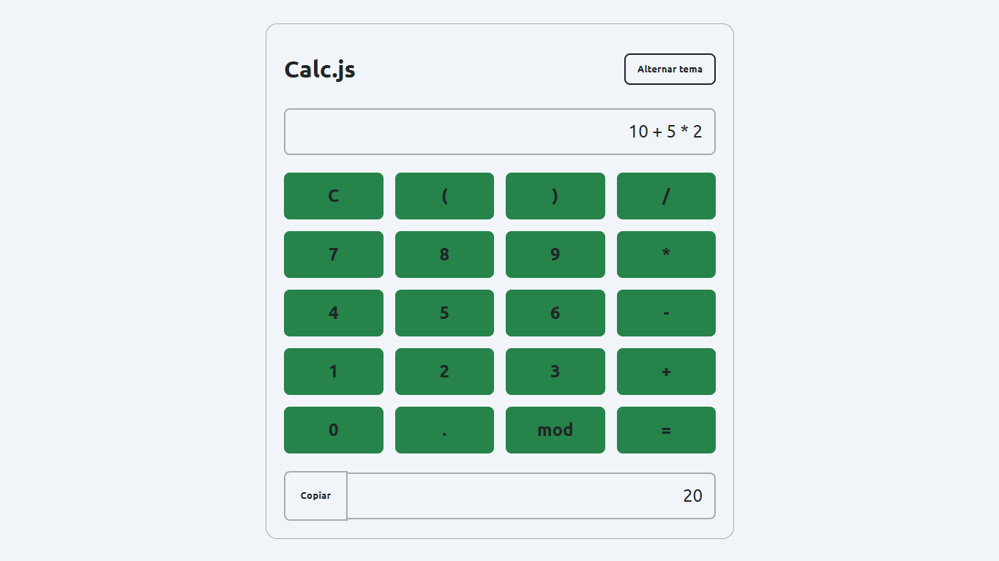

# Calc.js — Calculadora
## Demonstração

🔗 [Acessar calculadora online](https://renata-vitoria.github.io/calculadora-javascript/)

Uma calculadora desenvolvida com **HTML5, CSS3 e JavaScript**, como parte dos meus estudos em desenvolvimento web.

O projeto tem como objetivo praticar conceitos fundamentais de desenvolvimento front-end, incluindo manipulação do DOM, eventos JavaScript, operações matemáticas e estilização com CSS.

## Funcionalidades

- Operações matemáticas de adição, subtração, multiplicação e divisão.
- Cálculo de resto da divisão (MOD).
- Utilização de parênteses em expressões matemáticas.
- Entrada de operações pelo teclado.
- Botão para limpar a expressão.
- Exibição dos resultados.
- Cópia do resultado para a área de transferência.
- Alternância entre tema escuro e claro.
- Interface adaptável a diferentes tamanhos de tela.

## Tecnologias utilizadas

- HTML5
- CSS3
- JavaScript

## Como executar o projeto

1. Faça o download ou clone este repositório.
2. Abra a pasta do projeto.
3. Execute o arquivo `index.html` em seu navegador.
4. Comece a utilizar a calculadora.

Não é necessário instalar dependências ou configurar um servidor.

## Objetivo do projeto

Este projeto faz parte da minha jornada de aprendizado em desenvolvimento de software, colocando em prática conceitos estudados e desenvolvendo minhas habilidades com tecnologias web.

---

**Projeto desenvolvido para fins educacionais.**